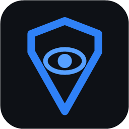
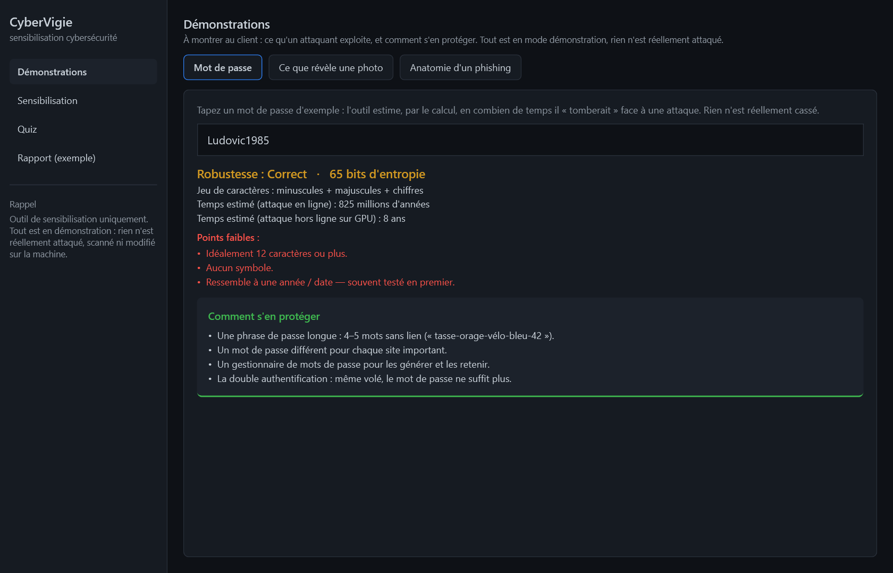
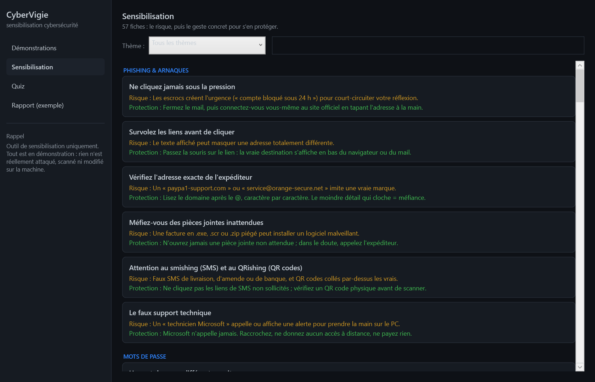
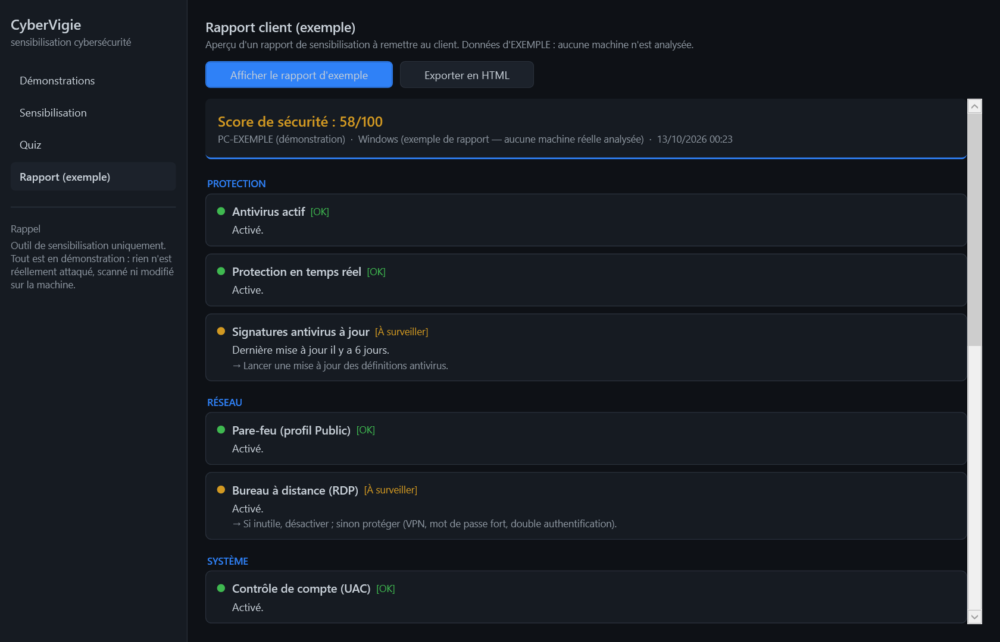

# 🛡️ CYBERVIGIE

### Comprendre ce qu'un pirate peut faire… et apprendre à s'en protéger.

*Un logiciel de **sensibilisation** à la cybersécurité, pensé pour être montré et compris. 
Il met en scène, en démonstration, les pièges les plus courants — mots de passe faibles, photos qui vous trahissent, faux courriels — et donne à chaque fois le bon réflexe.*

 

> ### ⚠️ Outil de sensibilisation uniquement
> **CyberVigie ne fait rien de réel sur les machines.** Il ne scanne pas, n'analyse pas et ne modifie
> **aucun** fichier ni réglage. Tout fonctionne en **mode démonstration**, avec des exemples : le but est
> **d'apprendre et de faire prendre conscience**, jamais d'attaquer quoi que ce soit.

 

 

<i>La démonstration « mot de passe » : on tape un exemple, l'outil estime par le calcul en combien de temps il « tomberait », pointe ses faiblesses, et donne la parade.</i>

  

[**Pourquoi**](#-pourquoi-cybervigie-) · [**Les démonstrations**](#-les-démonstrations) · [**Le contenu**](#-le-contenu) · [**En images**](#-en-images) · [**Télécharger**](#-télécharger) · [**Questions fréquentes**](#-questions-fréquentes)

 

---

## 🎯 Pourquoi CyberVigie ?

La plupart des victimes d'arnaques en ligne ne sont pas « imprudentes » : elles n'ont simplement
jamais **vu** comment fonctionne un piège. Les discours abstraits (« méfiez-vous du phishing »)
ne marquent pas. **Voir**, en revanche, ça marque.

CyberVigie est fait pour ça : **montrer concrètement** ce qu'un attaquant exploite, puis donner
immédiatement **le bon geste pour s'en protéger**. Idéal pour se former soi-même, sensibiliser ses
proches, ou accompagner un particulier ou une petite entreprise.

> **Rien n'est réel.** Chaque module est une démonstration à base d'exemples. CyberVigie ne touche
> à aucun de vos fichiers, de vos comptes ni de vos réglages.

 

## 🔍 Les démonstrations

<table>
<tr>
<td width="50%" valign="top">

### 🔑 Force d'un mot de passe
Tapez un mot de passe d'exemple : l'outil estime, **par le calcul** (rien n'est réellement cassé),
en combien de temps il tomberait, liste ses points faibles, et explique comment en choisir un solide.

</td>
<td width="50%" valign="top">

### 📷 Ce que révèle une photo
Sur un exemple, découvrez tout ce qu'une simple photo peut trahir : **date, modèle d'appareil et
même le lieu exact (GPS)**. Puis comment nettoyer ces informations avant de partager.

</td>
</tr>
<tr>
<td width="50%" valign="top">

### 🎣 Anatomie d'un phishing
Un faux courriel typique, **décortiqué signal par signal** : expéditeur usurpé, lien trompeur,
urgence, pièce jointe piégée… avec la parade pour chacun.

</td>
<td width="50%" valign="top">

### 📄 Rapport d'exemple
Un rapport de sensibilisation **fictif** (score, points à corriger), exportable en HTML et
imprimable en PDF. Aucune machine n'est analysée : c'est un modèle pédagogique.

</td>
</tr>
</table>

 

## 📚 Le contenu

- **57 fiches de sensibilisation** réparties sur **14 thèmes** : phishing & arnaques, mots de passe,
  sauvegarde & rançongiciel, mises à jour, réseau & Wi-Fi, mobile, navigation web, réseaux sociaux
  & vie privée, ingénierie sociale, banque, enfants & famille, pro/TPE, objets connectés, et
  « que faire en cas de piratage ». Chaque fiche : **le risque**, puis **le geste concret**.
- **Un quiz** avec une explication après chaque réponse.
- **Filtre par thème et recherche** pour retrouver un sujet en un instant.

 

## 🖼️ En images

<i>Démonstration — force d'un mot de passe.</i>

  

<i>Sensibilisation — 57 fiches classées par thème, risque + protection.</i>

  

<i>Rapport d'exemple — fictif, exportable en HTML. Aucune machine n'est analysée.</i>

 

## 💻 Configuration

- **Windows 10 ou 11** (64 bits)
- Aucune installation de .NET requise : la version portable est **autonome**.
- Télécharger, décompresser, lancer `CyberVigie.exe`.

 

## ⬇ Télécharger

👉 **[Dernière version (gratuite)](https://github.com/lerapeurdu62280-debug/CyberVigie-Download/releases/latest)**

1. Téléchargez le fichier `CyberVigie-1.0.0-portable.zip`.
2. Décompressez-le où vous voulez.
3. Lancez `CyberVigie.exe`. C'est tout.

 

## ❓ Questions fréquentes

**Est-ce que le logiciel attaque ou scanne mon ordinateur ?**
Non. **Jamais.** CyberVigie est un outil de sensibilisation : tout est en démonstration, sur des
exemples. Il ne lit, ne modifie et n'envoie **rien** de votre machine.

**À qui s'adresse-t-il ?**
À tous ceux qui veulent comprendre les pièges du numérique : particuliers, familles, petites
entreprises, et toute personne qui souhaite sensibiliser son entourage.

**Pourquoi la version portable est-elle volumineuse ?**
Parce qu'elle embarque tout le nécessaire pour fonctionner **sans rien installer**.

**Est-ce gratuit ?**
Oui, totalement.

 

---

Un outil <b>S.O.S INFO LUDO</b> — sensibilisation à la cybersécurité. Windows · gratuit.

